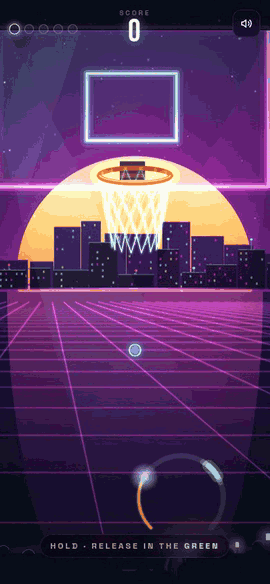
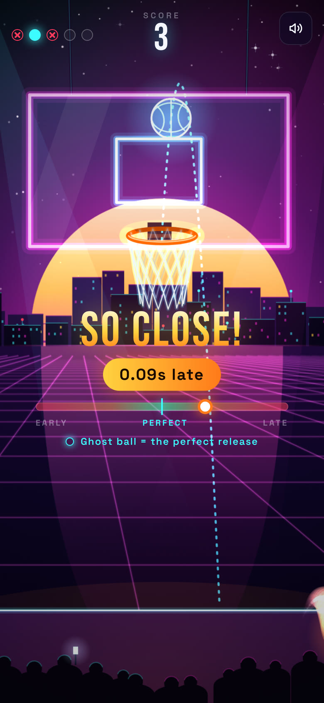
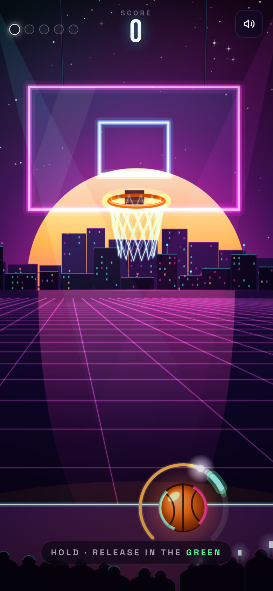
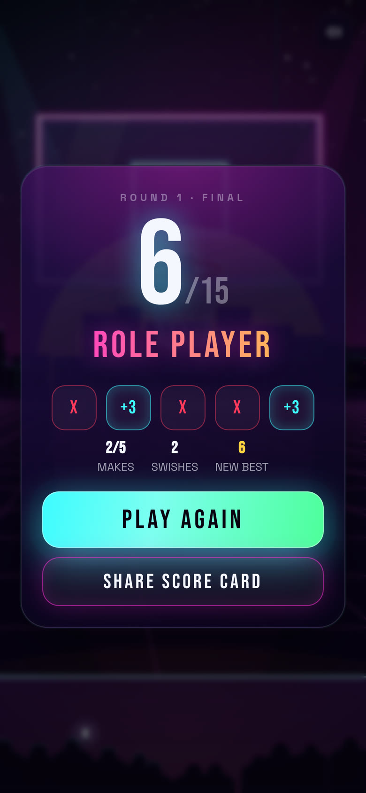
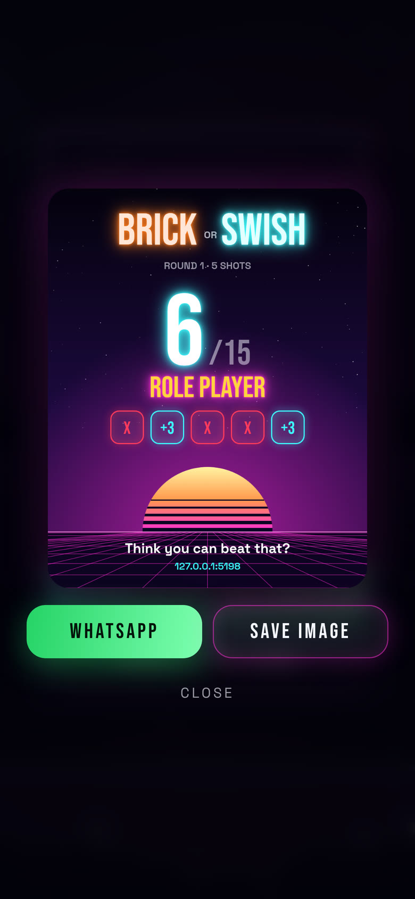
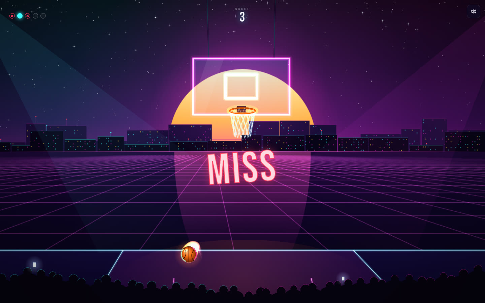

# Brick or Swish

**A one-button neon basketball game that is also a real A/B test.** Five free throws, one button, and a Flagsmith
experiment on the moment that decides whether a player comes back: the miss.

Built for the WeMakeDevs × Flagsmith **Toggle Wars** hackathon, Track 01 (Flagsmith Experimentation).

<p align="center">
  
</p>

## The pitch

Every casual game loses players at the first miss. A plain `MISS` says "you failed". A near miss says "you were *this*
close", which is the feeling that makes people press **Play again**.

So the miss screen is the experiment:

| `control` | `near_miss` |
| --- | --- |
|  |  |
| A plain **MISS** or **BRICK** stamp. | **SO CLOSE! 0.09s late**: the exact timing error, a timing strip, and a ghost ball replaying the perfect release. |

> **Hypothesis** (pre-registered in [HYPOTHESIS.md](HYPOTHESIS.md) before launch): showing near-miss feedback after a
> missed shot increases the share of players who start a second round.

Everything else (meter, physics, sound, slow-mo, dwell time, results screen) is identical in both arms, so only the
feedback differs.

## How Flagsmith is used

Flagsmith does the real work here: it buckets each player, records the exposure at the moment the variant is seen, and
computes the result with its Bayesian engine. The game never decides who sees what.

### Flags

| Flag | Type | Variations (key) | Why |
| --- | --- | --- | --- |
| `miss_feedback` | Multivariate, string | `control`, `near_miss` | The experiment. The miss screen renders from this flag's variant. |
| `aa_sanity_check` | Multivariate, string | `control`, `aa_b` | A/A test with the same exposure point and metrics. Both arms render identically, so a "winner" means broken tracking. Run it first. |

### Identity, exposure and events

1. **Identity before flags.** Each browser gets a stable anonymous id (`anon_<uuid>` in `localStorage`). The SDK starts
   with `preventFetch: true` and calls `identify(id, { platform })` before any flag is read, so bucketing is per player.
2. **Exposure at the point of display.** `getExperimentFlag('miss_feedback')` is called when the first miss screen
   renders, which records `$flag_exposure` for enrolled identities only. Players who never miss are never enrolled. The
   assignment is then locked for the session, so a late response can't flip a player mid-game.
3. **Conversions on the same identity.** Event names are constants in
   [`src/flagsmith/flags.ts`](src/flagsmith/flags.ts) and match the metrics exactly:

| Event | Sent when | Metric | Role |
| --- | --- | --- | --- |
| `second_round_started` | A player starts round 2 or later | Occurrence, higher is better | **Primary** |
| `quit_within_10s` | The tab is hidden or closed within 10 s of the first miss, with no shot, round or share since | Occurrence, lower is better | **Guardrail** |
| `shots_taken` | On tab hide/close, `value` = shots this session | Mean | Informational |
| `round_completed` | End of every round, `value` = score (0-15) | Mean | Informational (optional) |
| `score_shared` | The player opens the share flow | Occurrence | Informational (optional) |

4. **Nothing lost on exit.** Events flush on round end, `visibilitychange` (hidden) and `pagehide`, and event requests use
   `fetch(..., { keepalive: true })` so the last batch survives the tab closing.
5. **Safe when Flagsmith is down.** No key, a network failure, or flags that still haven't loaded at the first miss mean
   the game plays on `control`, records no exposure, and logs why to the console (`[BrickOrSwish/flagsmith] ...`) and
   the X-ray panel.

All of this lives in [`src/flagsmith/`](src/flagsmith/); the game code never touches the SDK. `npm run test:e2e` checks
the whole contract in Chrome with the real SDK and Flagsmith's endpoints intercepted (identify first, exposure at the
first miss, conversions after it on the same identity, flush on hide, guardrail, offline fallback).

### Experiment design

- 100% of identities, 50/50 split, exposure at the first miss screen.
- Planned sample: **375 exposed identities per arm** (baseline 35% replay, +10 pp minimum effect, α 0.05, power 0.8).
- Stopping rule, guardrail rule, SRM rule and "no mid-test edits" are written down in [HYPOTHESIS.md](HYPOTHESIS.md).
- Setup steps for the dashboard and the Flagsmith CLI: [docs/flagsmith-setup.md](docs/flagsmith-setup.md).

Open the game with `?debug` (or press **X**) for the X-ray panel: visitor id, connection status, assigned variant,
exposures and every event as it is sent.

## Quick start

```bash
npm install && npm run dev        # http://localhost:5173 (plays on control until you add a key)
```

To connect Flagsmith, copy `.env.example` to `.env` and set your client-side environment key, then follow
[docs/flagsmith-setup.md](docs/flagsmith-setup.md) to create the flags, metrics and experiments.

| Variable | Required | Purpose |
| --- | --- | --- |
| `VITE_FLAGSMITH_ENVIRONMENT_KEY` | For the experiment | Client-side environment key (safe in the browser). |
| `VITE_FLAGSMITH_API` | No | Self-hosted API URL. |
| `VITE_FLAGSMITH_EVENTS_API` | No | Self-hosted events URL. |
| `VITE_FORCE_MISS_FEEDBACK` | No | `control` or `near_miss` for UI QA. Never records an exposure. Same as `?force=`. |
| `FLAGSMITH_ENVIRONMENT_KEY` | Simulator only | Key of a separate **Demo** environment for simulated traffic. |

| Command | What it does |
| --- | --- |
| `npm run dev` | Dev server with hot reload. |
| `npm run build` | Type-check and build the static site to `dist/`. |
| `npm run preview` | Serve the production build. |
| `npm run test:e2e` | Flagsmith wiring checks in Chrome (set `CHROME_PATH` if needed). |
| `npm run simulate` | **Simulated** traffic generator, see below. |
| `npm run screenshots` | Regenerate `docs/screenshots/`. |

## Simulated traffic

`scripts/simulate-traffic.mjs` creates synthetic players with the real Node SDK (`@flagsmith/nodejs`): each one shoots
until its first miss, gets the experiment flag for its own identity (recording the exposure), then sends the same events
as the game. It is clearly labeled as simulated: ids are `sim_<uuid>`, the trait `simulated=true` is set, and every event
carries `metadata.simulated=true`. It refuses to run against the game's own environment key, and is meant for a separate
Demo environment so the real result is never polluted.

```bash
npm run simulate -- --dry-run                                     # local only, nothing sent
FLAGSMITH_ENVIRONMENT_KEY=<demo key> npm run simulate -- --flag aa_sanity_check --sessions 400
FLAGSMITH_ENVIRONMENT_KEY=<demo key> npm run simulate -- --flag miss_feedback --sessions 800 --lift 0.10
```

## Deploy (Vercel)

The game is a static Vite build (`vercel.json` is included).

1. Import the repo in Vercel. Framework preset **Vite**, build `npm run build`, output `dist` (picked up from `vercel.json`).
2. **Settings › Environment Variables**: add `VITE_FLAGSMITH_ENVIRONMENT_KEY` (Production environment's client-side key).
3. Deploy. `VITE_` variables are baked in at build time, so redeploy after changing them.

Or from the CLI: `npx vercel` to link, `npx vercel env add VITE_FLAGSMITH_ENVIRONMENT_KEY production`, then `npx vercel --prod`.

## Screenshots

| Mobile | | | |
| --- | --- | --- | --- |
|  |  |  |  |
| Title | Timing meter | Swish | Results |
|  |  |  | |
| Brick, `control` | Brick, `near_miss` | Share card | |

| Desktop `control` miss | Desktop `near_miss` miss |
| --- | --- |
|  |  |

## How the game works

- **One button.** Hold anywhere (or Space) to charge the ring meter, release in the green. A quick tap starts the meter
  and a second tap releases it.
- **Timing is everything.** The release error in seconds decides the shot: within 30 ms is a swish (+3), 60 ms a make
  (+2), 110 ms a rim-out, beyond that a brick or an airball. The meter speeds up every shot.
- **Feel.** Physics-like ballistic arcs, a glowing trail, a spring net, rim and backboard contacts, slow-mo rim rattles
  on near misses, crowd reactions and synthesized sound (WebAudio, no audio files), haptics on mobile.
- **Light.** Vanilla TypeScript, Canvas 2D and DOM, no framework, no image or audio assets: about 39 KB gzipped.

```
src/
  main.ts              wires game, UI, telemetry and the experiment client
  config.ts            env vars and URL switches (?force=, ?debug)
  flagsmith/           everything Flagsmith: identity, client, flags/events, telemetry
  game/                world projection, shot planner, net, particles, renderer, game loop
  audio/sfx.ts         synthesized SFX, crowd and haptics
  ui/                  HUD, miss feedback variants, results, share card, X-ray panel
scripts/
  simulate-traffic.mjs SIMULATED traffic (Node SDK)
  e2e/                 Flagsmith wiring check and screenshot capture (Chrome)
```

## Phase 2: Third Umpire

Next up is an AI "Third Umpire": a Python + Flagsmith CLI agent, packaged as an agentskills.io Agent Skill, that audits
the running experiment against [HYPOTHESIS.md](HYPOTHESIS.md) (sample ratio mismatch, peeking, guardrail breaches, novelty
effects, post-launch edits) and asks a human before acting. The experiment client and event contract are kept in one
place so it can audit them without touching the game.

## AI tools used

_To be filled in by the author._
