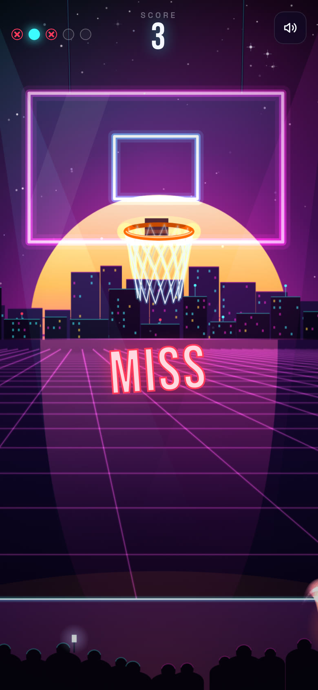
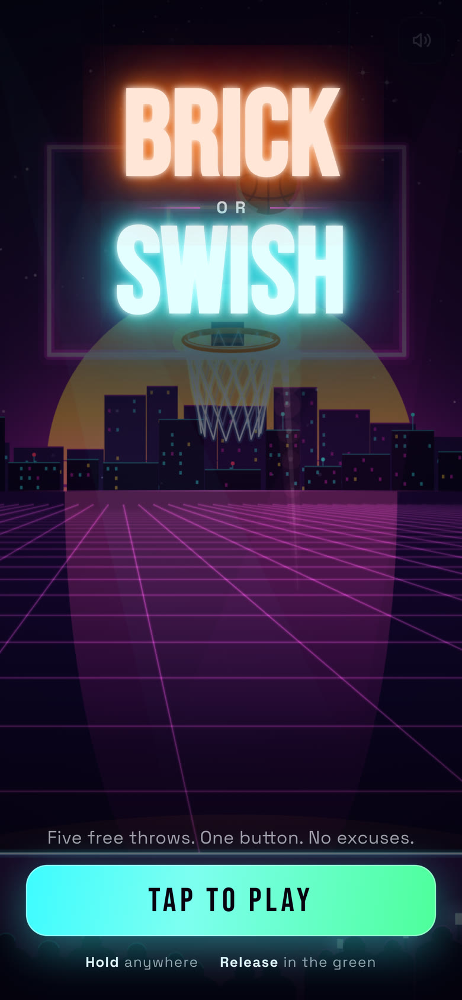
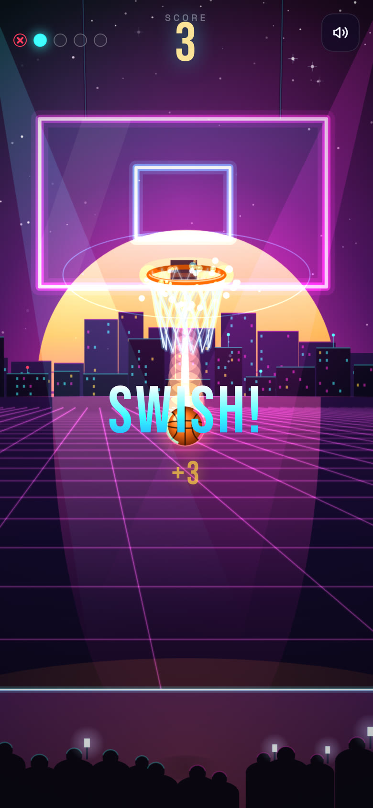
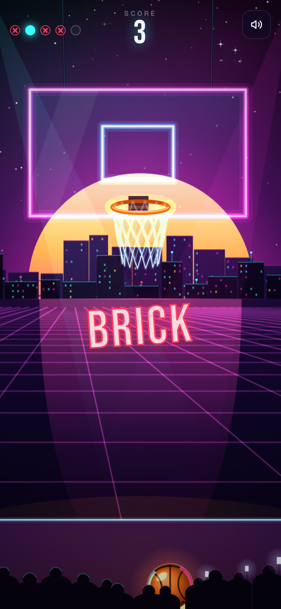
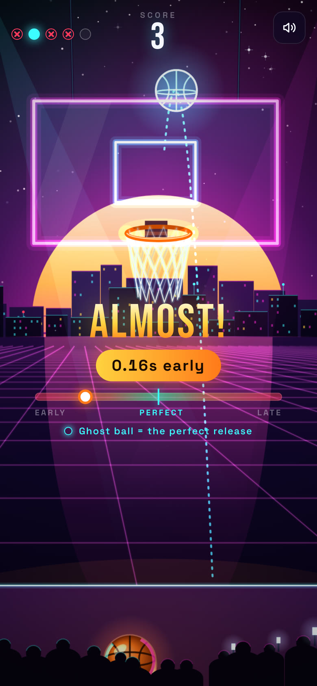
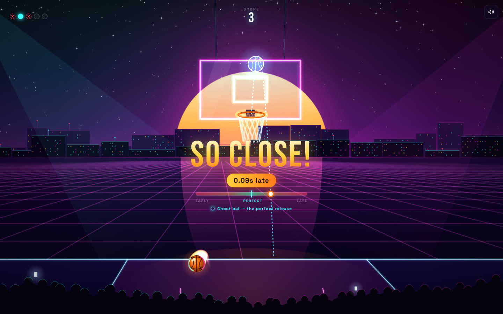
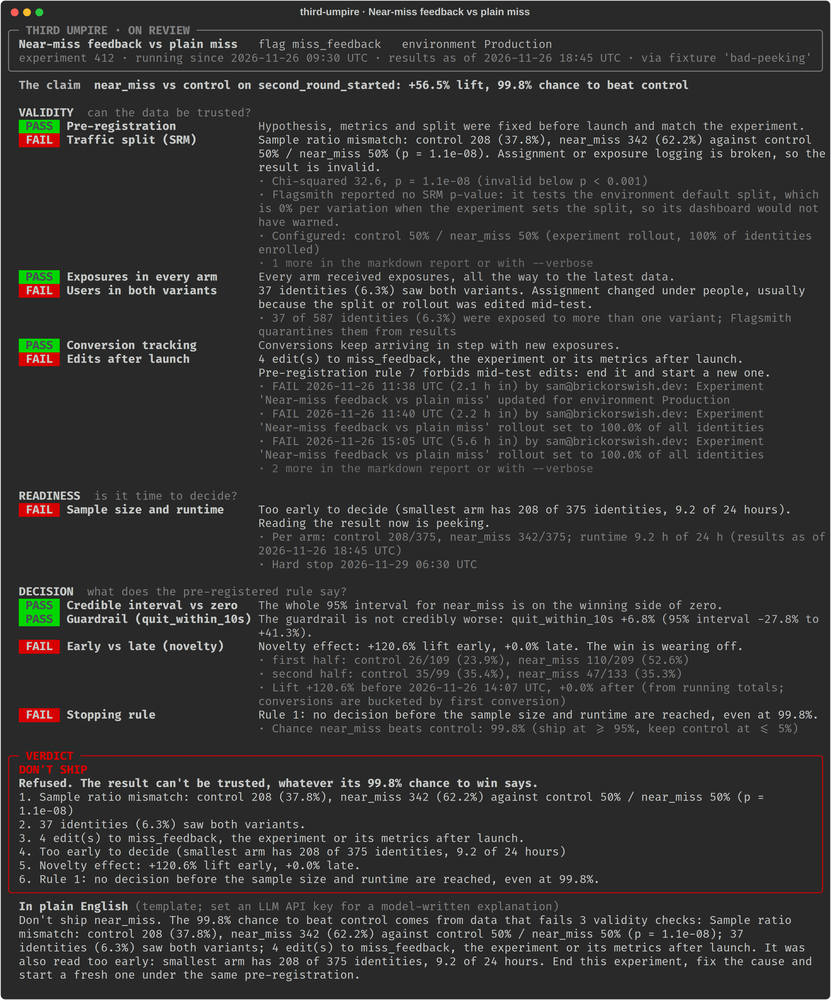
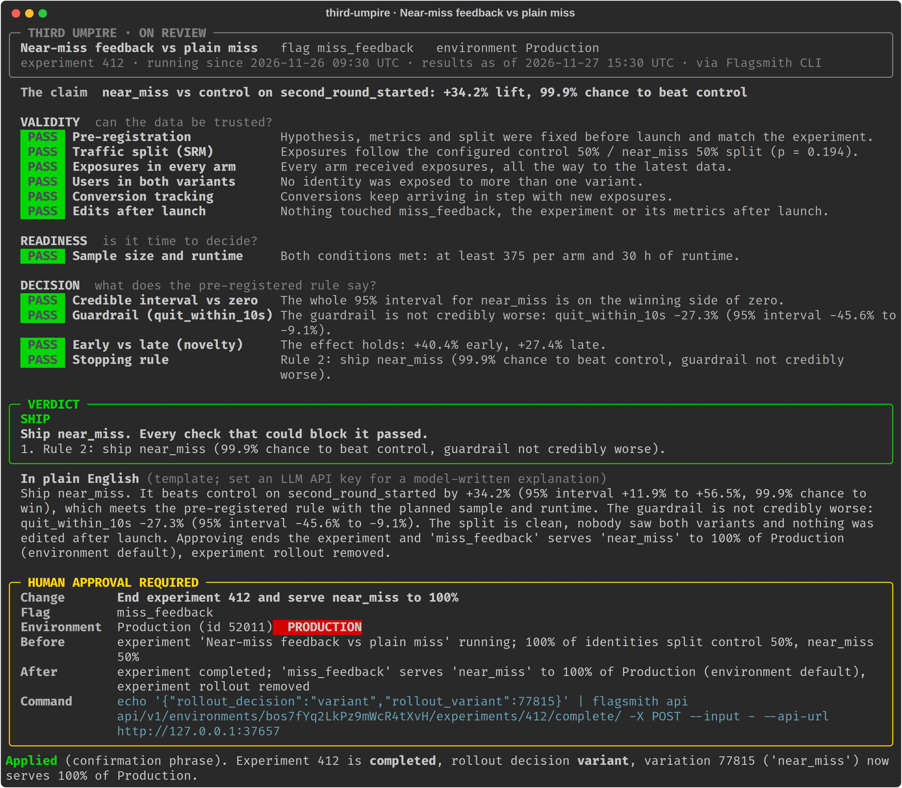
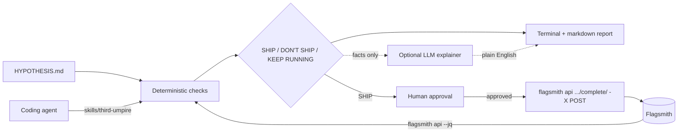

# Brick or Swish

**A one-button neon basketball game that is also a real A/B test.** Five free throws, one button, and a Flagsmith
experiment on the moment that decides whether a player comes back: the miss.

Built for the WeMakeDevs × Flagsmith **Toggle Wars** hackathon: Track 01 (Flagsmith Experimentation) with the game,
and Tracks 02 and 04 with [Third Umpire](#tracks-02-and-04-third-umpire), an agent and Agent Skill that reviews the
result before anyone ships it.

<p align="center">
  
</p>

## The pitch

Every casual game loses players at the first miss. A plain `MISS` says "you failed". A near miss says "you were *this*
close", which is the feeling that makes people press **Play again**.

So the miss screen is the experiment:

| `control` | `near_miss` |
| --- | --- |
|  |  |
| A plain **MISS** or **BRICK** stamp. | **SO CLOSE! 0.09s late**: the exact timing error, a timing strip, and a ghost ball replaying the perfect release. |

> **Hypothesis** (pre-registered in [HYPOTHESIS.md](HYPOTHESIS.md) before launch): showing near-miss feedback after a
> missed shot increases the share of players who start a second round.

Everything else (meter, physics, sound, slow-mo, dwell time, results screen) is identical in both arms, so only the
feedback differs.

## How Flagsmith is used

Flagsmith does the real work here: it buckets each player, records the exposure at the moment the variant is seen, and
computes the result with its Bayesian engine. The game never decides who sees what.

### Flags

| Flag | Type | Variations (key) | Why |
| --- | --- | --- | --- |
| `miss_feedback` | Multivariate, string | `control`, `near_miss` | The experiment. The miss screen renders from this flag's variant. |
| `aa_sanity_check` | Multivariate, string | `control`, `aa_b` | A/A test with the same exposure point and metrics. Both arms render identically, so a "winner" means broken tracking. Run it first. |

### Identity, exposure and events

1. **Identity before flags.** Each browser gets a stable anonymous id (`anon_<uuid>` in `localStorage`). The SDK starts
   with `preventFetch: true` and calls `identify(id, { platform })` before any flag is read, so bucketing is per player.
2. **Exposure at the point of display.** `getExperimentFlag('miss_feedback')` is called when the first miss screen
   renders, which records `$flag_exposure` for enrolled identities only. Players who never miss are never enrolled. The
   assignment is then locked for the session, so a late response can't flip a player mid-game.
3. **Conversions on the same identity.** Event names are constants in
   [`src/flagsmith/flags.ts`](src/flagsmith/flags.ts) and match the metrics exactly:

| Event | Sent when | Metric | Role |
| --- | --- | --- | --- |
| `second_round_started` | A player starts round 2 or later | Occurrence, higher is better | **Primary** |
| `quit_within_10s` | The tab is hidden or closed within 10 s of the first miss, with no shot, round or share since | Occurrence, lower is better | **Guardrail** |
| `shots_taken` | On tab hide/close, `value` = shots this session | Mean | Informational |
| `round_completed` | End of every round, `value` = score (0-15) | Mean | Informational (optional) |
| `score_shared` | The player opens the share flow | Occurrence | Informational (optional) |

4. **Nothing lost on exit.** Events flush on round end, `visibilitychange` (hidden) and `pagehide`, and event requests use
   `fetch(..., { keepalive: true })` so the last batch survives the tab closing.
5. **Safe when Flagsmith is down.** No key, a network failure, or flags that still haven't loaded at the first miss mean
   the game plays on `control`, records no exposure, and logs why to the console (`[BrickOrSwish/flagsmith] ...`) and
   the X-ray panel.

All of this lives in [`src/flagsmith/`](src/flagsmith/); the game code never touches the SDK. `npm run test:e2e` checks
the whole contract in Chrome with the real SDK and Flagsmith's endpoints intercepted (identify first, exposure at the
first miss, conversions after it on the same identity, flush on hide, guardrail, offline fallback).

### Experiment design

- 100% of identities, 50/50 split, exposure at the first miss screen.
- Planned sample: **375 exposed identities per arm** (baseline 35% replay, +10 pp minimum effect, α 0.05, power 0.8).
- Stopping rule, guardrail rule, SRM rule and "no mid-test edits" are written down in [HYPOTHESIS.md](HYPOTHESIS.md).
- Setup steps for the dashboard and the Flagsmith CLI: [docs/flagsmith-setup.md](docs/flagsmith-setup.md).

Open the game with `?debug` (or press **X**) for the X-ray panel: visitor id, connection status, assigned variant,
exposures and every event as it is sent.

## Quick start

```bash
npm install && npm run dev        # http://localhost:5173 (plays on control until you add a key)
```

To connect Flagsmith, copy `.env.example` to `.env` and set your client-side environment key, then follow
[docs/flagsmith-setup.md](docs/flagsmith-setup.md) to create the flags, metrics and experiments.

| Variable | Required | Purpose |
| --- | --- | --- |
| `VITE_FLAGSMITH_ENVIRONMENT_KEY` | For the experiment | Client-side environment key (safe in the browser). |
| `VITE_FLAGSMITH_API` | No | Self-hosted API URL. |
| `VITE_FLAGSMITH_EVENTS_API` | No | Self-hosted events URL. |
| `VITE_FORCE_MISS_FEEDBACK` | No | `control` or `near_miss` for UI QA. Never records an exposure. Same as `?force=`. |
| `FLAGSMITH_ENVIRONMENT_KEY` | Simulator only | Key of a separate **Demo** environment for simulated traffic. |

| Command | What it does |
| --- | --- |
| `npm run dev` | Dev server with hot reload. |
| `npm run build` | Type-check and build the static site to `dist/`. |
| `npm run preview` | Serve the production build. |
| `npm run test:e2e` | Flagsmith wiring checks in Chrome (set `CHROME_PATH` if needed). |
| `npm run simulate` | **Simulated** traffic generator, see below. |
| `npm run screenshots` | Regenerate `docs/screenshots/`. |

## Simulated traffic

`scripts/simulate-traffic.mjs` creates synthetic players with the real Node SDK (`@flagsmith/nodejs`): each one shoots
until its first miss, gets the experiment flag for its own identity (recording the exposure), then sends the same events
as the game. It is clearly labeled as simulated: ids are `sim_<uuid>`, the trait `simulated=true` is set, and every event
carries `metadata.simulated=true`. It refuses to run against the game's own environment key, and is meant for a separate
Demo environment so the real result is never polluted.

```bash
npm run simulate -- --dry-run                                     # local only, nothing sent
FLAGSMITH_ENVIRONMENT_KEY=<demo key> npm run simulate -- --flag aa_sanity_check --sessions 400
FLAGSMITH_ENVIRONMENT_KEY=<demo key> npm run simulate -- --flag miss_feedback --sessions 800 --lift 0.10
```

## Deploy (Vercel)

The game is a static Vite build (`vercel.json` is included).

1. Import the repo in Vercel. Framework preset **Vite**, build `npm run build`, output `dist` (picked up from `vercel.json`).
2. **Settings › Environment Variables**: add `VITE_FLAGSMITH_ENVIRONMENT_KEY` (Production environment's client-side key).
3. Deploy. `VITE_` variables are baked in at build time, so redeploy after changing them.

Or from the CLI: `npx vercel` to link, `npx vercel env add VITE_FLAGSMITH_ENVIRONMENT_KEY production`, then `npx vercel --prod`.

## Screenshots

| Mobile | | | |
| --- | --- | --- | --- |
|  |  |  |  |
| Title | Timing meter | Swish | Results |
|  |  |  | |
| Brick, `control` | Brick, `near_miss` | Share card | |

| Desktop `control` miss | Desktop `near_miss` miss |
| --- | --- |
|  |  |

## How the game works

- **One button.** Hold anywhere (or Space) to charge the ring meter, release in the green. A quick tap starts the meter
  and a second tap releases it.
- **Timing is everything.** The release error in seconds decides the shot: within 30 ms is a swish (+3), 60 ms a make
  (+2), 110 ms a rim-out, beyond that a brick or an airball. The meter speeds up every shot.
- **Feel.** Physics-like ballistic arcs, a glowing trail, a spring net, rim and backboard contacts, slow-mo rim rattles
  on near misses, crowd reactions and synthesized sound (WebAudio, no audio files), haptics on mobile.
- **Light.** Vanilla TypeScript, Canvas 2D and DOM, no framework, no image or audio assets: about 39 KB gzipped.

```
src/
  main.ts              wires game, UI, telemetry and the experiment client
  config.ts            env vars and URL switches (?force=, ?debug)
  flagsmith/           everything Flagsmith: identity, client, flags/events, telemetry
  game/                world projection, shot planner, net, particles, renderer, game loop
  audio/sfx.ts         synthesized SFX, crowd and haptics
  ui/                  HUD, miss feedback variants, results, share card, X-ray panel
scripts/
  simulate-traffic.mjs SIMULATED traffic (Node SDK)
  e2e/                 Flagsmith wiring check and screenshot capture (Chrome)
umpire/                Third Umpire: Python CLI over the Flagsmith CLI, fixtures, tests
skills/third-umpire/   the same workflow as an Agent Skill
```

## Tracks 02 and 04: Third Umpire

A 99% chance to win is not a reason to ship. It can come from a broken split, from peeking after nine hours, or from
someone editing the rollout mid-test. **Third Umpire** reviews a Flagsmith experiment before anyone ships the winner:
it reads everything through the Flagsmith CLI, runs deterministic checks against the pre-registration in
[HYPOTHESIS.md](HYPOTHESIS.md), and calls **SHIP**, **DON'T SHIP** or **KEEP RUNNING**. The only write it can make
(ending the experiment with the winner at 100%) waits for a human to approve the exact change.

- **Track 02 (agent):** [`umpire/`](umpire/), a Python CLI on top of the official Flagsmith CLI.
- **Track 04 (Agent Skill):** [`skills/third-umpire/`](skills/third-umpire/SKILL.md), the same workflow as an
  [agentskills.io](https://agentskills.io/specification) skill for coding agents.

| Planted bad result: refused | Healthy result: approved, rolled out through the Flagsmith CLI |
| --- | --- |
|  |  |



**What it checks.** Each check returns PASS, WARN or FAIL with its numbers, and code, not a model, makes the call.

- **Validity:**
  - sample ratio mismatch, recomputed against the experiment's own split, because Flagsmith's SRM test reads the
    environment default and stays silent here;
  - users exposed to both variants;
  - an arm that stops receiving exposures;
  - conversions flatlining while exposures grow;
  - edits to the flag, experiment, rollout or metrics in the audit log after launch.
- **Readiness:** the pre-registered sample size and runtime.
- **Decision:**
  - the 95% credible interval against zero, re-derived from Flagsmith's raw sums;
  - the `quit_within_10s` guardrail;
  - an early-vs-late novelty split;
  - the pre-registered stopping rule.

Details and thresholds are in [CHECKS.md](skills/third-umpire/references/CHECKS.md).

**Safety.**
- Nothing is written without a SHIP verdict and a human approving the exact change: `y`, then the environment's name
  for production, or `--approve "ship near_miss to 100% in Production"` typed by a human when an agent drives it.
- `--dry-run` prints the exact `flagsmith api` command and sends nothing.
- The experiment is re-read just before writing, and the umpire refuses if anything moved since the review.
- The optional LLM (OpenAI, Anthropic or xAI, set with `UMPIRE_LLM_PROVIDER` and `UMPIRE_LLM_API_KEY`) only rewords
  the facts. Its text is checked against the verdict and falls back to a template, so it can never change the call.

### Run it

Needs [uv](https://docs.astral.sh/uv/) (or Python 3.10+) and, for live runs, the
[Flagsmith CLI](https://docs.flagsmith.com/integrating-with-flagsmith/flagsmith-cli) v2.

```bash
cd umpire
uv run third-umpire review --fixture bad-peeking      # planted bad result: DON'T SHIP (exit 2)
uv run third-umpire review --fixture healthy          # SHIP; approve at the prompt (fixture writes are simulated)
uv run third-umpire review --fixture keep-running     # clean but too early: KEEP RUNNING (exit 3)
```

Against the live experiment:

```bash
flagsmith login                                    # or: export FLAGSMITH_API_KEY=<Master API key>
export FLAGSMITH_ENVIRONMENT=<Production client-side key>
uv run third-umpire list                           # experiments in the environment
uv run third-umpire review --dry-run               # the one running experiment; show the rollout, send nothing
uv run third-umpire review                         # same, then ask before rolling out
```

Through the real Flagsmith CLI against a local mock of the API (what the recording shows):

```bash
uv run third-umpire serve-fixture healthy --port 8765 &
export FLAGSMITH_API_URL=http://127.0.0.1:8765 FLAGSMITH_API_KEY_127_0_0_1_8765=mock.third-umpire-demo
uv run third-umpire review -e bos7fYq2LkPz9mWcR4tXvH
```

Each review also writes a markdown report to `umpire-reports/`. Exit codes: 0 ship (applied or dry run), 2 don't ship,
3 keep running, 4 ship awaiting approval, 1 error. `uv run --extra test pytest` runs the 114 tests: every check has
passing and failing cases, and one suite drives the real Flagsmith CLI against the mock API.

### As an Agent Skill

Copy or symlink `skills/third-umpire` into your agent's skills folder, for example `.claude/skills/` or
`.cursor/skills/`. Inside this repo its launcher runs `umpire/` directly, and anywhere else it installs it from GitHub
with `uvx`. The agent runs `scripts/preflight`, then `scripts/umpire review --json`, relays the verdict by exit code,
and passes `--approve` only with a phrase the human typed. The skill validates with
`uvx --from skills-ref agentskills validate skills/third-umpire`.

It is built to be cheap: a full demo run (activation, preflight, refusing the bad result, reviewing and approving the
healthy one) puts **3,210 tokens** in the agent's context. The umpire reads about 8,000 tokens of raw API responses per
review itself, and the agent only sees a ~500-token summary. `skills/third-umpire/scripts/measure-tokens` re-measures
this, and `--token-log FILE` records the count for any run, including a live one
([TOKENS.md](skills/third-umpire/references/TOKENS.md)).

## AI tools used

_To be filled in by the author._
